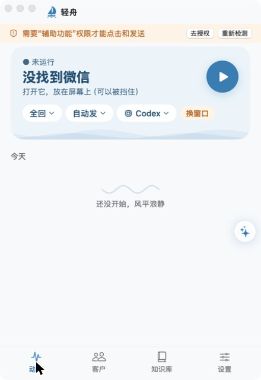
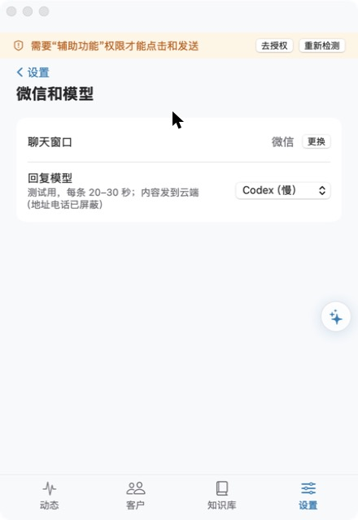
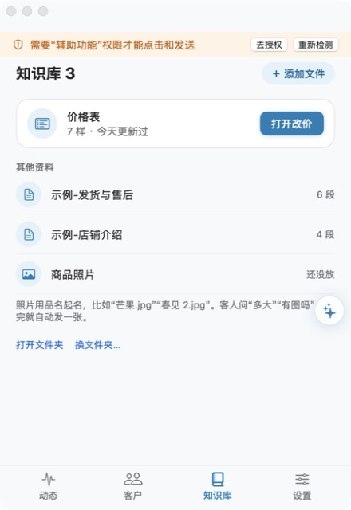
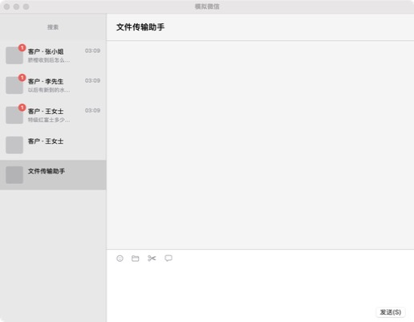
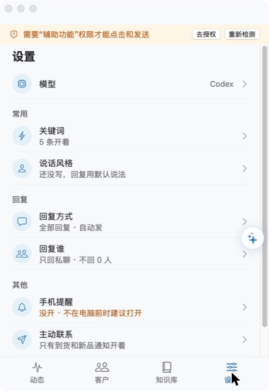

# 使用教程

从零开始，大约 15 分钟。先在自带的“模拟微信”上练手，满意了再用到真微信。

视频版（约 1 分 40 秒）：

视频文件：[教程视频.mp4](https://github.com/paperlantern-dev/qingzhou-assistant/blob/main/docs/%E6%95%99%E7%A8%8B%E8%A7%86%E9%A2%91.mp4?raw=true)

https://github.com/user-attachments/assets/f8bb3fe9-ccbc-49f0-a34b-027b423585c9

## 1. 下载

需要一台 macOS 14 以上的 Mac。

### 方法一：直接下载（不用懂编程）

1. 到 [下载页](https://github.com/paperlantern-dev/qingzhou-assistant/releases/latest) 下载 `qingzhou-assistant-0.1.0.zip`，双击解压。
2. 把 **轻舟助手** 拖到“应用程序”文件夹，双击打开。
3. 第一次打开，Mac 会提示“无法验证开发者”（这个应用没有花钱买苹果的开发者签名）。打开 系统设置 › 隐私与安全性，往下拉，点 **仍要打开**。只需要做一次。

知识库会自动放在 `文稿/轻舟助手知识库`，里面先有一份示例。

解压出来还有一个 **模拟微信**，第 5 步练手用。

### 方法二：自己编译

打开“终端”，依次运行：

```bash
xcode-select --install
```

```bash
git clone https://github.com/paperlantern-dev/qingzhou-assistant.git
```

```bash
cd qingzhou-assistant && ./scripts/build_app.sh
```

完成后 `build/` 文件夹里有两个应用：**轻舟助手** 和 **模拟微信**。

## 2. 第一次打开，给两个权限

打开轻舟助手（自己编译的话：`open build/模拟微信.app build/轻舟助手.app`）。



顶部黄条会提示缺什么权限，点“去授权”，在 系统设置 › 隐私与安全性 里允许“轻舟助手”：

| 权限 | 用来做什么 |
|---|---|
| 屏幕录制 | 截聊天窗口的图来读消息（只在本机处理） |
| 辅助功能 | 点输入框、打字、按回车 |

给完权限点“重新检测”。重新编译后如果又要求授权，是因为应用签名变了，再允许一次即可。

## 3. 填你自己的 API Key

本项目不带任何 Key。到你选的平台（DeepSeek、通义千问、OpenAI，或任何兼容 OpenAI 格式的服务）申请一个。



1. 设置 › 模型
2. “回复模型”选 **API 直连**
3. 选一家，粘贴 Key，点“测试”，显示通过就好了

Key 存在 Mac 的“钥匙串”里，不会写进任何文件。

不想把聊天内容发到云端：安装 [Ollama](https://ollama.com) 后在“回复模型”里选 Ollama，回答质量会弱一些。

## 4. 放你的知识库



点“打开文件夹”，里面现在是一家虚构水果店的示例。**删掉示例，换成你自己的**：

- **价格表**：一个 csv 文件，第一行写 `品名,规格,价格,说明`，一行一样商品。
- **其他资料**：发货、售后、营业时间、常见问题，写成 txt 或 md，用标题分段。
- **商品照片**（可选）：放进 `商品照片` 文件夹，用品名起文件名，比如 `红富士.jpg`。

AI 只按这里的资料回答。资料里没有的，它不会编，会交给你。

想确认效果：设置里的“试问一句”，输入客人可能问的话，看它怎么答，不会发给任何人。

## 5. 在模拟微信上试



双击打开 **模拟微信**。想让三位“客人”自动发消息，在它的“模拟器控制”窗口里打开自动剧本（自己编译的话也可以运行 `open -n build/模拟微信.app --args --shop`）。

1. 轻舟助手首页点“换窗口”，选 **模拟微信**
2. 点大的播放按钮开始
3. 模拟微信里三位“客人”会陆续发消息，看轻舟助手怎么回

想自己扮客人：模拟微信会带一个“模拟器控制”窗口，选一位客人，打字发送。

随时可以**连按两下 Esc** 暂停。

## 6. 用到真微信



建议按这个顺序，别一上来就全自动：

1. 设置 › 回复方式：选 **只回有把握的** + **我确认后发**。每条回复先出现在首页，你点了才发。
2. 设置 › 回复谁：把家人、朋友、供应商加进“不自动回复”。
3. 打开微信，轻舟助手首页“换窗口”选微信，点开始。
4. 跑一两天，回得不对就点“回得不好？教它”，或者直接改知识库。
5. 放心了再改成“自动发”。群聊建议一直关着。

设置 › 关键词 里已经放好 5 条常用规则（售后、找真人、讲价、付款、问有什么卖），按你的情况改。

## 常见问题

**它不回消息？**
看首页的运行记录。常见原因：知识库是空的；这个问题资料里没有（“只回有把握的”模式下会交给你）；对方在“不自动回复”名单里；到了每小时发送上限。

**提示“读得不对”然后停了？**
微信升级后版面可能变了，或者窗口太小。把微信窗口拉大一点，点“再检查一次”。

**会不会回错人？**
每次发送前会再看一眼是不是同一个聊天，发完还会确认消息出现在这个聊天里。同名的群和私聊分开算。

**我的聊天内容会发到哪里？**
截图只在本机处理。发给 AI 的是聊天文字和相关的知识库片段，地址、电话、姓名、证件号先换成占位符。用本机模型则完全不出电脑。

**微信会不会封号？**
这个工具是模拟人点击和打字，不是官方接口，风险需要你自己判断。建议控制发送频率（默认每小时最多 20 条），不要用来群发营销。
